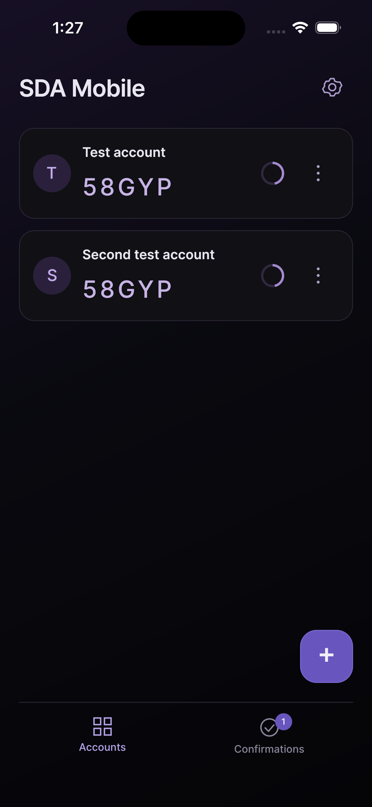
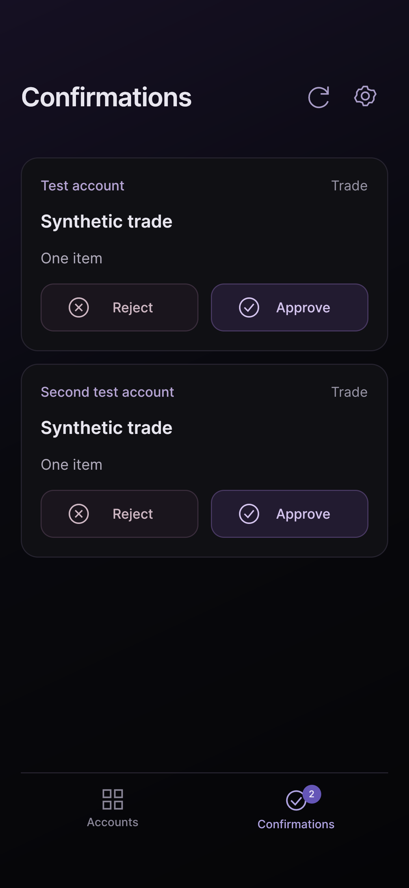
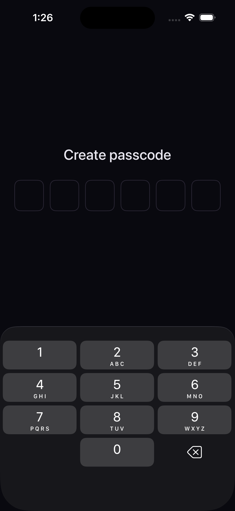

# iOS companion

The iOS client is an experimental C# / Avalonia companion for iPhone and iPad running iOS
16 or later. It reuses `src/SteamAuth` and the desktop file-encryption implementation.
The interface and account services live in `src/Mobile/` and `src/Mobile.Core/`.
Installation and use have been confirmed on an iPhone 14 Pro; this remains an initial
iOS implementation with additional device coverage and recovery testing needed.

Current iPhone simulator screenshots with synthetic accounts:



The mobile interface uses a midnight black / indigo gradient, charcoal cards, and muted
lavender accents. Accounts and Confirmations are the two main tabs. The account layout
follows Android: avatar, name/code, an unnumbered countdown ring, and a three-dot dropdown.
Tapping the name or code copies the code. The floating plus button offers import, scan,
paste, and linking. The header gear opens app settings; there is no search or Vault tab.




Confirmations combine all saved accounts, with each item labeled by its account. Pull
down or use the small header refresh icon to reload. Session refresh, JWT expiry, Steam
time, list parsing, and responses use explicit JSON parsing in the mobile HTTP client.
A rejected access token gets one refresh/retry before the account requests sign-in.
An unavailable account does not hide other accounts' confirmations. Approve/reject
always uses the item's owning account and preserves unsigned 64-bit IDs/nonces.
The Confirmations tab carries the pending-count badge; there is no separate bell.
Count checks run on unlock, return, and account/confirmation changes, using temporary
session copies without writing the vault or blocking offline codes. Failed background
checks retain the last known count. Errors and reauthentication appear in the combined
list on explicit refresh. Settings contains only security controls; backup, transfer QR,
sign-in, and removal live in each account's dropdown.

## Windows-only build and install

You do not need a Mac or a paid Apple Developer membership for this personal sideloading
workflow. GitHub Actions supplies the Mac that compiles the device binary; Sideloadly on
your Windows PC signs and installs it with your own Apple Account.

1. Open the fork's **Actions** tab. If GitHub has disabled workflows on the new fork, enable
   them. The **iOS IPA** workflow runs for relevant changes on `main` or `ios` and for pull
   requests. Once it is on the repository's default branch, **Run workflow** can also
   build a selected branch. Before that, push the `ios` branch to trigger its first run.
2. Open the successful run and download the **SDA-Mobile-iOS-unsigned** artifact.
3. Extract the artifact ZIP. The installable file is `SDA-Mobile-iOS-unsigned.ipa`, not the
   outer ZIP. A SHA-256 checksum is included.
4. Install Sideloadly and the web-download versions of iTunes and iCloud linked from
   [Sideloadly's official site](https://sideloadly.io/). Connect the iPhone by USB, unlock it,
   and accept **Trust This Computer** if prompted.
5. Drop the IPA into Sideloadly, select the phone, and sign in with your free Apple Account
   directly in Sideloadly. Do not add Apple credentials to repository secrets or send them
   to a contributor.
6. Press **Start**, complete Apple's verification prompts, and wait for **Done**.
   If the app reports **Untrusted Developer**, go to **Settings > General > VPN & Device
   Management**, choose the Apple Account used to install, and trust it. Enable
   **Settings > Privacy & Security > Developer Mode** if requested, then restart and
   confirm. [Apple documents Developer Mode here](https://developer.apple.com/documentation/xcode/enabling-developer-mode-on-a-device).
7. Enable Sideloadly's automatic refresh. Free-account signatures expire after seven days;
   refresh the installed app with the same Apple Account and bundle ID. The PC must be
   running and able to reach the phone by USB or configured Wi-Fi. The same IPA can be
   re-signed; a weekly rebuild on GitHub is unnecessary.

Open SDA Mobile and create/confirm the six-digit passcode, then use **+** to add an
account. To update, install the new IPA over the existing app using the same Apple
Account and bundle ID. Keep an encrypted account export before uninstalling or changing
that identity. See the [Sideloadly FAQ](https://sideloadly.io/faq) for device detection,
developer trust, Wi-Fi pairing, and automatic refresh.

The cloud build produces an **unsigned ARM64 device app**, not a simulator or App Store
archive. It cannot launch until Sideloadly has signed and installed it. Free provisioning
usually permits three installed apps. This workflow requests no push, iCloud, App Group,
or other paid provisioning capabilities. The cloud runner never receives account files,
Steam credentials, an Apple password, a signing certificate, or a provisioning profile.

The workflow pins .NET SDK/workload set **10.0.401**, iOS workload **26.5.10318**, and
**Xcode 26.6** on the standard Intel `macos-26-intel` runner. This avoids the ARM64
runner capacity queue; the installable device app still targets **ios-arm64**. Only
the simulator check uses **iossimulator-x64** to match its host. Update the toolchain as a compatible set using Microsoft's
[iOS release notes](https://github.com/dotnet/macios/releases/tag/dotnet-10.0.1xx-xcode26.5-10318).
Do not update just Xcode. Standard GitHub-hosted runners are free for public repositories;
private repositories consume the account's Actions allowance.

The app uses a concrete UIKit application delegate and Avalonia's public embedding API.
This avoids the generic native delegate that failed Objective-C construction during
startup with this SDK. The native delegate has a unique Objective-C name, is explicitly
selected at entry, and preserves its callback methods through the build pipeline.
The workflow also builds and launches an ad-hoc-signed iPhone simulator
app, checks that its process remains running and its screenshot contains visible content,
and includes that startup screenshot with the
IPA artifact. This launch check supplements the physical-device test; it does not sign or
install the device IPA.

Simulator verification and device compilation run in parallel. The final IPA artifact is
assembled only after both succeed; a surviving process with a black screen fails validation.

The iOS asset catalog contains the theme-matched lock icon in all required sizes, including
an opaque 1024-pixel source. On Windows, regenerate it with `tools/Generate-IosIcons.ps1`.

## Account workflows

- **Scan desktop QR:** imports the same `sda-mafile:v1:` compressed payload as Android, or
  legacy JSON QR codes. QR exports exclude session credentials. The import reads the
  account username, requires the Steam password and any Steam Guard verification, then
  saves the authenticated account. Camera permission is requested only when scanning.
- **Import files:** select plaintext `.maFile` files, or encrypted `.maFile` files together
  with their `manifest.json`. Supply the source passkey when prompted. Encrypted backup
  ZIPs exported by the iOS client contain standard maFiles and a standard manifest.
  UTF-8, UTF-16, and UTF-32 files with byte-order marks are recognized like the desktop
  importer. The source encryption passkey and Steam account password serve different
  purposes: the former decrypts a source file; the latter completes the required sign-in.
- **Paste account data:** copy the plaintext maFile JSON or an SDA QR payload, then tap
  **Paste account data**. A native multiline editor provides Apple's user-authorized Paste
  control and system editing menu. Continue to the required Steam sign-in. Imports show
  progress and return to Accounts with a success or error message. Account parsing and
  encryption run away from the UI thread. An account is not saved when sign-in is cancelled
  or rejected. Steam IDs are checked before an existing account can be replaced.
- **Codes:** generated locally every second, including offline. Steam's clock is aligned
  asynchronously when the vault is unlocked. Tap the account's name or code to put the
  current code on the device-local clipboard for 30 seconds.
- **Confirmations:** open the **Confirmations** tab to see pending items from all saved
  accounts. Pull down or tap the header refresh icon to reload, then approve or reject
  each entry. An expired access token is refreshed automatically while its refresh token
  remains valid; otherwise the affected account offers **Sign in**. Passwords are not saved.
  During sign-in, a saved, enrolled authenticator supplies its own Steam Guard code when
  its Steam ID matches the account Steam is authenticating. Email codes are entered manually.
- **Link new account:** sign in and complete Steam's phone, email, and SMS prompts. The
  pending authenticator is saved encrypted before the activation-code prompt. Record the
  revocation code offline. If interrupted, select the pending account, sign in if needed,
  and choose **Finish linking** in its three-dot menu. Test linking with a disposable account.
- **Backups:** open the account's three-dot menu and choose **Export backup**. Choose and confirm a backup
  password; the ZIP contains encrypted account data compatible with SDA's existing crypto.
  To use it with desktop, extract its contents into a separate maFiles directory. Keep the
  password and revocation code separately. **Show transfer QR** is an explicit plaintext transfer.
- **Remove from device:** deletes the local account only. It does not deactivate Steam
  Guard at Valve. Keep a backup before removing an account or uninstalling the app.

## Security and platform behavior

Account files live in the iOS app's private data directory, not the read-only application
bundle. Each file uses the existing AES-256-CBC / PBKDF2-SHA1 SDA format; the random local
vault passkey is protected by a required **6-digit numeric passcode**. Existing 8-digit
passcodes remain supported. A legacy wrapper's length is recorded after successful
unlock without changing its ciphertext. New and changed passcodes use six digits.
The iPhone uses a full-screen native passcode page with the system number keyboard and
submits automatically on the last digit. Incorrect entries remain on the same page.
Opening the app shows the themed icon, fades it out, and presents the passcode directly;
there is no intermediate Unlock button. A transparent PNG removes the icon's square
background. The OS launch storyboard uses the same icon,
and native prompts wait for the host view's appearance callback before presenting.
The native window belongs to a single `UIWindowScene`; its scene delegate forwards
activation and background events to the existing passcode timeout and privacy cover.
The scene delegate uses a concrete `UIResponder` with explicitly exported protocol
callbacks, following [Microsoft's native iOS template](https://github.com/dotnet/macios/blob/main/dotnet/Templates/Microsoft.iOS.Templates/ios/csharp/SceneDelegate.cs).
On first use
or upgrade, choose and confirm the passcode before viewing accounts. The existing vault
key is wrapped with AES-256-GCM (a random 16-byte salt, 12-byte nonce, and 16-byte tag).
The wrapping key is derived with PBKDF2-SHA256, 210,000 iterations, from the passcode
combined with a random device secret using HMAC-SHA256. The wrapper and device secret
live in iOS Keychain with `WhenUnlockedThisDeviceOnly` accessibility. The previous raw
Keychain vault key is removed after the wrapper is saved. Existing maFiles are unchanged.
Five incorrect passcodes trigger a persisted 30-second delay, increasing to 15 minutes
with further failures. A successful unlock resets the counter. Use **Settings > Change
passcode** to change it after supplying the current passcode. There is no passcode reset
that bypasses protection: keep a separately encrypted export for recovery.

The account directory is excluded from automatic backups. A missing Keychain key or unreadable
account fails closed instead of silently resetting or replacing the vault. Export an
encrypted backup before uninstalling, changing the signing identity, or changing bundle ID.

Saves stage a new encrypted maFile before atomically replacing the manifest, so a failed
manifest write retains the previous salt, IV, and ciphertext together. Incoming manifest
paths and decompressed import sizes are bounded. Error messages do not display raw JSON,
HTTP request URLs, credentials, or token-bearing response bodies.

The app covers its native window before iOS captures an app-switcher snapshot. Entering
the background stops the code timer and closes QR exports. A monotonic timer allows
short returns without asking for the passcode again. After **15 minutes in the
background**, account/confirmation views and the unlocked vault are cleared; returning
requires the passcode. A fresh process launch always requires it. The interval is the
chosen convenience setting, not a universal industry standard; timeout selection depends
on the application's risk and usage, as described in [OWASP's guidance](https://cheatsheetseries.owasp.org/cheatsheets/Session_Management_Cheat_Sheet.html).
The native privacy cover hides the entire window while switching apps. **Settings > Lock
app** immediately cancels operations and clears the account views. There is no continuous background polling, auto-confirmation,
push service, biometric gate, or saved-password auto-login. Revocation through Steam is
left to Steam's account management; **Remove from device** is deliberately a local action.

The desktop-compatible CBC format is retained for interoperability; it does not add an
authentication tag. This client does not introduce a new maFile schema. Real-device
validation is required before using a primary account.

## Local development and verification

On Windows, install .NET 10 SDK and the .NET 8 runtime (the original desktop target).

```powershell
dotnet build SteamDesktopAuthenticator.sln -c Release
dotnet build src/Mobile.Desktop/Mobile.Desktop.csproj -c Release
dotnet test tests/Mobile.Core.Tests/Mobile.Core.Tests.csproj -c Release
dotnet run --project src/Mobile.Desktop/Mobile.Desktop.csproj
dotnet run --project src/Mobile.Desktop/Mobile.Desktop.csproj -- --demo

dotnet run --project src/Mobile.Desktop/Mobile.Desktop.csproj -- --demo --require-passcode
dotnet run --project src/Mobile.Desktop/Mobile.Desktop.csproj -- --demo --snapshot-directory dist/ios/ui
```

The preview uses an isolated temporary directory and an ephemeral key. Demo mode uses
the synthetic passcode `123456` for its initial unlock, solely in the Windows preview.
Subsequent manual unlocks use the full-page keypad. To review the opening transition and enter the demo PIN manually, use
`--demo --require-passcode` and enter `123456`. Use synthetic
accounts only: it is a layout/debug tool, not a desktop credential store. Camera scanning
is native to iOS. It does not read the original desktop maFiles directory.

CI also runs a simulator-only functional check using a separate synthetic vault and
namespaced Keychain entries: native multiline input and dismissal, file/QR/pasted import
with simulated Steam authentication responses, code generation, incorrect
passcode rejection, persistent unlock, passcode change, and invalid-input feedback. The
test harness is excluded from device builds. Its screenshot and result log accompany
the build artifact. This does not exercise a real Steam login or approve a real trade.
The authentication simulation exercises the production HTTP login client and iOS RSA
cryptography against an in-process HTTP handler, including a refresh-token-only success
response. It also exercises production JWT/time/session refresh and combined confirmation
HTTP calls against the synthetic handler, including owner-specific cookies and a nonce
larger than signed 64-bit range. Native passcode retry/automatic-submit, account-menu UI,
and confirmation screenshots contain only synthetic test data.

Account files use an explicit JSON field reader/writer rather than reflection-based
model conversion. File, pasted JSON, legacy JSON QR, and compressed QR checks start
from an externally authored synthetic desktop-format fixture, including numeric
metadata and a null session ID. The fixture is excluded from device builds. Import
errors distinguish malformed JSON (I01), the root document type (I02), and a field
type mismatch (I03), without displaying any input values. Other decode/crypto errors
identify the operation stage with D01/D02/D03 codes.

Simulator boot follows compilation to avoid competing with the native compiler for
memory on standard runners. Screenshot verification uses Python/Pillow to avoid the cold
Swift/AppKit compilation that delayed earlier runs.
Boot runs in its own step using a fresh iPhone 14 Pro simulator. Each boot wait is
bounded to four minutes, with one recovery attempt on another fresh device and an
eight-minute total budget. Failed devices are shut down, and boot logs are retained.
An unsuccessful simulator boot fails before installing the app; it never counts as a
successful startup check or permits the final validated IPA artifact.
Startup checks wait for the native passcode's appearance marker instead of a fixed
sleep. Detached foreground launches also require an exact process-specific readiness
file, preventing a previous launch from satisfying the check. The waiter has standalone
tests for delayed/missing files, stale process IDs, and an incomplete host-only launch.
Native crash reports fail the readiness check immediately, including a crash after
the ready marker, so a terminated app cannot pass the console readiness check.
The iOS compiler treats warnings as errors. Artifact upload/download actions are pinned
to versions using Node 24, and the simulator verifies that the scene owns the native host.

On a Mac with the pinned Xcode and .NET versions:

```sh
export DEVELOPER_DIR=/Applications/Xcode_26.6.app/Contents/Developer
dotnet workload install ios --version 10.0.401
dotnet publish src/iOS/iOS.csproj -c Release -r ios-arm64 \
  -p:EnableCodeSigning=false -p:CodesignRequireProvisioningProfile=false \
  -p:BuildIpa=false -p:ArchiveOnBuild=false
```

The workflow packages the resulting `.app` inside `Payload/` in the IPA. Release enables
the supported Mono interpreter for managed code, including Avalonia's generated XAML
populate methods that failed during AOT-only startup. Native rendering libraries remain
ARM64 binaries. This mode runs managed IL without enabling JIT compilation; it can be
slower than full AOT for managed workloads. Reflection-based JSON models are preserved
with `TrimMode=copy`. The desktop project retains its existing framework and UI.

Before marking iOS support stable, use a disposable Steam account to verify QR and file
imports, matching rotating codes, login/Steam Guard challenges, token refresh, approving
and rejecting real confirmations, new linking and interrupted linking recovery, encrypted
backup recovery, camera denial/cancellation, background privacy, and Sideloadly renewal.
